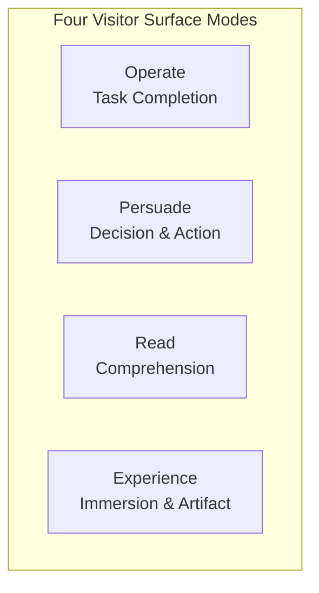

# Design & UX Craft Standard: Modes, Typography Physics, Refusal Matrix & Microcopy

This document establishes the advanced aesthetic and interaction craft standards refined from director-level UX engineering. It operates as the foundational companion to `design-tokens.css` and `ui-8-states-guide.md`.

---

## 1. Four Surface Modes & Purpose-Driven Ambition

Interface ambition must scale to the surface's primary visitor mode. Misapplying marketing aesthetics to operational tools—or administrative flatness to landing pages—is an architectural failure.



### Mode 1: Operate (App UI, Dashboards, Settings, Workbenches)
* **Objective**: The user is inside a task. The tool must disappear into the workflow.
* **Core Philosophy**: Scanability, information density, consistency, and earned familiarity outrank expressive visual experiments.
* **Execution Rules**:
  - Prefer a single well-tuned font family (e.g., Inter, system sans) over display/body pairings;
  - Headings use fixed scale ratios (1.125 ~ 1.25) rather than aggressive fluid clamp values;
  - Density is a virtue: tables with 50+ rows, compact toolbars, and rich keyboard navigation are expected;
  - Transitions must remain brisk (150ms ~ 250ms); never force users to sit through choreographed page-load animations.

### Mode 2: Persuade (Landing Pages, Marketing, Pricing, Product Launches)
* **Objective**: The visitor decides and acts; design *is* the product.
* **Core Philosophy**: Earn attention, project authority, and communicate unique value with a sharp point of view.
* **Execution Rules**:
  - Display typography carries the voice with decisive scale contrast;
  - Single authored focal motion sequence or interactive narrative moment;
  - High emotional resonance via tailored photography, rich micro-sheen textures, and distinct hero accents.

### Mode 3: Read (Documentation, Knowledge Bases, Changelogs, Long-Form)
* **Objective**: The visitor understands, studies, and retains information.
* **Core Philosophy**: Frictionless typographical rhythm, clear reading measures, and intuitive table-of-contents navigation.
* **Execution Rules**:
  - Body measure strictly bounded between `45ch ~ 75ch`;
  - Generous line height inversely proportional to column width;
  - Uncluttered margin notes, code blocks with accessible contrast, and instant copy affordances.

### Mode 4: Experience (Portfolios, Interactive Showcases, Galleries)
* **Objective**: The visitor enters the creative work itself.
* **Core Philosophy**: The artifact leads from the first viewport; navigation and surrounding UI recede into ambient backgrounds.

---

## 2. Typography Physics & Advanced Line-Break Aesthetics

Typography is physical and spatial. It carries structure before text is even read.

### Progressive Wrapping (`balance` & `pretty`)
* **Headings & Short Titles**: Always declare `text-wrap: balance;` on `h1`-`h4`, hero captions, and short callouts. Browsers evenly distribute line lengths, eliminating awkward single-word wraps.
* **Body & Paragraphs**: Declare `text-wrap: pretty;` on body text (`p`, blockquotes). It dynamically pulls a companion word down to eliminate trailing orphan words on the final line.

```css
/* Typography Physics Defaults */
h1, h2, h3, h4, .hero-title, .modal-title {
  text-wrap: balance;
  letter-spacing: -0.02em;
}

p, li, blockquote {
  text-wrap: pretty;
  max-width: 68ch; /* Optimal reading measure */
}
```

### Optical Dark-Mode Compensation
Light text against deep dark backgrounds suffers from **optical irradiation** (light spill causes glyphs to bleed into the dark and appear heavier than they are):
* **Weight Adjustment**: If using heavy medium/semibold weights in light mode, step down one weight grade in dark mode (e.g., `font-weight: 500` instead of `600`);
* **Tracking & Leading**: Add subtle positive tracking (`letter-spacing: +0.01em ~ +0.015em`) and expand line height by 2%~5% to preserve legibility in dark surfaces.

### Tabular Numerals in Data Surfaces
Any interface showing metrics, timers, financial balances, stock numbers, or tabular data must force fixed-width numerals:
```css
.tabular-nums, .metric-value, table td.numeric, .countdown {
  font-variant-numeric: tabular-nums;
  font-feature-settings: "tnum" 1;
}
```

---

## 3. The Craft Refusal Matrix (Anti-Slop Standards)

Recognizing and actively refusing unexamined defaults separates staff-grade craft from amateur assembly:

| Category | Unexamined Slop Default | Director-Grade Refusal Standard |
| :--- | :--- | :--- |
| **Containers** | Nested cards (card inside a card) | **Strictly Ban Nested Cards**. Differentiate hierarchy via flat 1px borders, subtle tint shifts, or structural whitespace. |
| **Eyebrows / Kickers** | Tiny uppercase tags (`FEATURES`, `ABOUT US`) stacked above headings | **Delete the Eyebrow**. Let the heading carry its own weight and communicate context directly. |
| **Depth** | Hard offset zero-blur shadows (`box-shadow: 4px 4px 0`) | **Refuse Hard Block Shadows** unless the committed aesthetic is authentic neobrutalism. Use natural ambient light occlusion. |
| **Typography** | Monospace as a costume for "tech vibe" | Reserve monospace strictly for actual code, hashes, keys, data arrays, and measurements. |
| **Interruptive Flow** | Defaulting to modals for non-critical tasks | **Avoid Modals by Default**. Exhaust inline expansion, split panes, drawers, or undo-capable operations first. |
| **Gradients** | Large-area linear gradient backgrounds on body, sidebars, or large cards | **Strictly Ban Large-Surface Gradients**. Confine gradients exclusively to micro-elements (tags, 1px borders, CTA micro-sheens). |
| **Surface Theming** | Leaving browser defaults on selection, cursor & scrollbars | **Theme Every Browser Surface** (selection color, caret, focus rings, scrollbars). |

### Gradient Scope & Scale Discipline (Micro-Accents Only)
AI models chronically abuse gradients by applying `linear-gradient(...)` across entire page bodies, hero sections, and large container cards. This creates an ungrounded, visually noisy "cheap tech-demo" aesthetic and degrades text contrast:

1. **Large-Surface Ban (No Background Washes)**:
   - Strictly prohibit gradient backgrounds on `body`, main page backdrops, sidebars, tables, and primary content cards;
   - 90% of the interface chassis must remain a clean, solid, luminous neutral (ivory/porcelain in light mode; 4-tier obsidian in dark mode).
2. **Permitted Micro-Scopes (The Only 4 Legitimate Use Cases)**:
   - **Micro-Badges & Tags**: Status pills, category chips, or "PRO" badges with small footprint ($\le 28\text{px}$ height);
   - **Single Hero CTA Button Micro-Sheen**: A single primary action button using subtle monochromatic 5%~10% luminance shifts (simulating silk or brushed metal specular reflection);
   - **1px Hairline Gradient Borders**: Subtle 1px gradient strokes (`border-image` or mask) creating delicate top-edge highlights on elevated cards;
   - **Sub-Perceptual Ambient Radial Glow**: Deep background ambient lighting in dark themes with sub-perceptual opacity ($\le 6\%$) and massive diffusion ($\ge 120\text{px}$ blur) positioned behind a focal artifact—never solid gradient blocks.
3. **Monochromatic Purity (No Cross-Spectrum Blends)**:
   - Gradients must stay strictly within the same hue family (e.g., deep amber to warm gold, slate to obsidian);
   - Strictly prohibit cross-spectrum rainbow collisions (e.g., indigo-to-purple-to-pink, cyan-to-lime).

### Full Browser Surface Theming
Amateur pages betray themselves when the user selects text or tabs through controls. All surfaces must be cohesive:
```css
/* 1. Styled text selection */
::selection {
  background: rgba(var(--color-primary-rgb), 0.18);
  color: var(--color-primary);
}

/* 2. Cohesive interactive caret */
input, textarea, [contenteditable="true"] {
  caret-color: var(--color-primary);
}

/* 3. Accessible dual-ring focus outline */
:focus-visible {
  outline: 2px solid var(--color-primary);
  outline-offset: 2px;
}

/* 4. Elegant custom scrollbar integration */
@supports (scrollbar-width: thin) {
  * {
    scrollbar-width: thin;
    scrollbar-color: var(--color-border-subtle) transparent;
  }
}
```

---

## 4. UX Copywriting, Error Anatomy & Safe Action Ergonomics

Microcopy is an engineering surface. Vague, blaming, or unhelpful copy represents a structural UX bug.

### The 3-Part Error Anatomy
Every user-facing error message must deterministically answer three questions without exposing internal server stack traces:
1. **What happened**: Clear, factual statement of the issue.
2. **Why it happened**: The immediate understandable cause (if known and safe to disclose).
3. **How to recover**: Specific, actionable resolution or viable alternative path.

```markdown
❌ Bad:  "Error 500: Failed to fetch workspace data. Check connection."
✅ Good: "Unable to load workspace members. The server took too long to respond. Check your internet connection or try refreshing the page."
```

### Undo over Interruptive Modal Prompts
* For reversible actions (archiving a project, removing an item from a list, updating a status), **execute immediately and provide a 5~8 second Undo toast**;
* Reserve blocking confirmation modals exclusively for **destructive, irreversible catastrophes** (permanently deleting a database, revoking an enterprise API credential).

### Explicit Action Naming on Buttons
* Confirmation buttons must explicitly name the verb and target noun;
* **Never use ambiguous generic labels**: Ban standalone "OK", "Yes", "Submit", or "Proceed";
* **Word Budget**: Action buttons must stay within **2 to 6 words** (`white-space: nowrap;`).
  - Examples: `Save Changes`, `Delete Workspace`, `Download CSV Report`.

### Empty States That Teach
Empty states must never render as a dead-end blank canvas ("No items found"):
1. **Contextual Illustration / Icon**: Clean SVG icon matching the domain;
2. **Explanatory Heading & Subtext**: Explain why it is empty (e.g., "No invoices generated yet");
3. **Primary Call to Action (CTA)**: The single immediate next step (e.g., `Create First Invoice`).

---

## 5. Semantic Motion Physics & Timing Budgets

Motion in professional software must explain state transitions and spatial continuity, never serve as decorative filler.

### Duration & Scale Calibration

| Duration | Physics Profile | Appropriate Usage |
| :--- | :--- | :--- |
| **100ms ~ 150ms** | `cubic-bezier(0, 0, 0.2, 1)` | Micro-feedback: button click depression, switch toggle, hover highlight. |
| **150ms ~ 250ms** | `cubic-bezier(0.16, 1, 0.3, 1)` | Component state: dropdown reveal, accordion slide, tab switch. |
| **300ms ~ 450ms** | `cubic-bezier(0.16, 1, 0.3, 1)` | Structural layout: slide-over drawer, mobile navigation tray, modal backdrop. |
| **500ms ~ 800ms** | Custom authored bezier | Singular hero entrance sequence (restricted to Persuade/Experience modes only). |

### Accessibility: `prefers-reduced-motion`
All engineered animations must respect user motion preferences:
```css
@media (prefers-reduced-motion: reduce) {
  *, ::before, ::after {
    animation-duration: 0.01ms !important;
    animation-iteration-count: 1 !important;
    transition-duration: 0.01ms !important;
    scroll-behavior: auto !important;
  }
}
```

---

## 6. Mini-Program & Cross-Platform Mobile Standards (WeChat, Uni-app, Taro)

When building for miniapps and hybrid mobile runtimes, general desktop web assumptions break catastrophically. The following six engineering standards are strictly mandatory:

### Rule 1: Zero Browser DOM Hallucination (Strict DOM Ban)
* **Never invoke browser-only globals**: Prohibit `window`, `document`, `location`, `localStorage`, `sessionStorage`, `alert()`, and `confirm()`.
* **Node Dimension Querying**: Query bounding rectangles strictly via the platform selector API:
  ```javascript
  // WeChat / Uni-app Selector Query
  const query = uni.createSelectorQuery().in(this);
  query.select('#target-node').boundingClientRect(rect => {
    if (rect) console.log(rect.height);
  }).exec();
  ```
* **Storage & Network**: Use platform APIs (`uni.getStorageSync` / `wx.getStorageSync`, `uni.request` / `wx.request`) configured with explicit timeouts.

### Rule 2: `setData` Communication Throttle & Payload Budgeting
Miniapp runtime is partitioned across dual threads (JS Logic Thread vs WebView Render Thread) bridged by JSON serialization:
* **Pre-Render Projection**: Strip unused properties before sending to views. Never serialize raw backend database records containing hundreds of unused keys;
* **Frequency Discipline**: Never call `this.setData()` inside unthrottled `onPageScroll`, `onMouseMove`, or raw input listeners. Throttle high-frequency updates to at least 16ms ~ 50ms intervals;
* **Incremental Path Patching**: For large lists, update only the target index:
  ```javascript
  this.setData({
    [`items[${targetIndex}].status`]: 'COMPLETED'
  });
  ```

### Rule 3: 750rpx Standard & Full-Screen Safe-Area Insets
* **Dimension Units**: Visual designs map to `rpx` (where screen width is strictly $750\text{rpx}$);
* **Bottom Action Bar Safe Area**: Fixed bottom buttons (checkout, submit, tab bars) must account for the system Home Indicator on modern mobile devices:
  ```css
  .fixed-bottom-bar {
    position: fixed;
    bottom: 0;
    left: 0;
    right: 0;
    padding-bottom: env(safe-area-inset-bottom);
    box-sizing: border-box;
  }
  ```

### Rule 4: Custom Navigation Bar & Capsule Button Avoidance
When disabling native navigation bars (`navigationStyle: "custom"`):
* **Dynamic Geometry Calculation**: Query the native menu button bounding rectangle dynamically:
  ```javascript
  const sys = uni.getSystemInfoSync();
  const capsule = uni.getMenuButtonBoundingClientRect();
  const navBarHeight = (capsule.top - sys.statusBarHeight) * 2 + capsule.height;
  ```
* **Avoidance**: Custom back buttons and page titles must strictly respect `capsule.left` to prevent visual collision with the native capsule controls.

### Rule 5: 2MB Main Package Budget & Asset Offloading
* **Main Package Ceiling**: Local package bundles must stay strictly beneath the **2MB** upload threshold;
* **Zero Heavy Assets**: Raster images exceeding 50KB must be hosted on external CDNs or converted to WebP. Never dump raw high-res artwork into local `assets/images/`;
* **Subpackaging**: Multi-page modules must be split into dedicated subpackages (`subPackages` in `app.json` / `pages.json`).

### Rule 6: Symmetric Lifecycle Cleanup on Unload
When a page navigates away or tears down (`onUnload` / `beforeDestroy`):
* Explicitly detach all global event bus listeners (`uni.$off()`, `wx.offNetworkStatusChange()`);
* Clear all running timers (`clearInterval`, `clearTimeout`) to prevent invisible background battery and memory drain.

---

## 7. Atomic UI Styling & Zero Raw-HTML Deliverables (Anti-Naked Frontend)

A frequent flaw in AI-generated software is delivering functional markup (HTML / WXML) while neglecting to write corresponding CSS / WXSS styles. Unstyled form inputs, unbordered tables, raw browser buttons, and unaligned text create unusable, defective interfaces.

**Rule**: All frontend functional components must ship with complete, atomic, production-ready styling matching design tokens. "Functional completion without visual completion" is considered a rejected deliverable.

### 1. Form Controls & Input Fields
* **Input, Select, Textarea**:
  - Explicit height, padding (`10px 14px`), border (`1px solid var(--border-subtle)`), and border-radius (`var(--radius-md)`);
  - Dual-ring `:focus-visible` styling (`outline: none; box-shadow: 0 0 0 2px var(--color-bg), 0 0 0 4px var(--color-primary)`);
  - Calibrated placeholder text color (`var(--text-muted)`);
  - Inline error feedback with red border and microcopy helper text beneath the field.
* **Checkboxes & Radios**:
  - Custom styled controls matching the brand accent color; never rely on raw browser checkboxes;
  - Accessible touch target wrapper ($\ge 44 \times 44\text{px}$).

### 2. Tables & Data Lists
* **Headers**: Subtle background contrast (`var(--surface-sunken)`), uppercase tracking, and sticky positioning when scrolling;
* **Row Hover & Striping**: Monochromatic row hover micro-sheen (`var(--surface-hover)`);
* **Responsive Scroll Container**: Wrap tables in `<div style="overflow-x: auto; -webkit-overflow-scrolling: touch;">` with min-width on columns to prevent layout breakdown on mobile screens;
* **Numeric Columns**: Align numbers to the right and declare `font-variant-numeric: tabular-nums;`.

### 3. Modals, Drawers & Overlays
* **Backdrop**: Semi-transparent dark ambient overlay (`background: rgba(0, 0, 0, 0.45); backdrop-filter: blur(4px);`);
* **Elevation**: High-depth ambient shadow (`var(--shadow-xl)`), centered placement, and smooth micro-scale entrance animation (`transform: scale(0.96) -> scale(1)`);
* **Actions**: Clear header title, padded body, and distinct bottom action bar with primary confirm and secondary cancel buttons.

### 4. Zero-State Feedback (Empty / Loading / Error)
* When a list or container has no data, never render a blank empty void. Render an engineered Empty State with an icon/illustration, descriptive microcopy (e.g., "No orders yet"), and a primary CTA button to create the first record.
