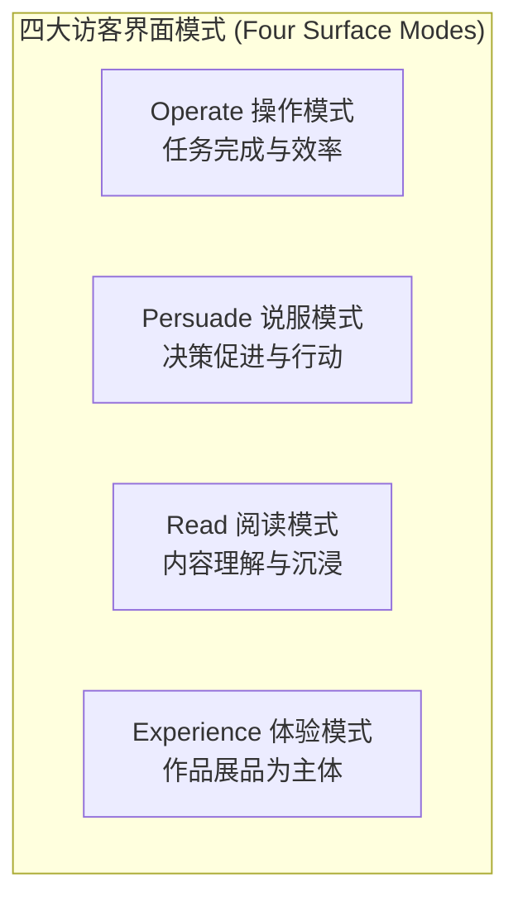

# 设计与交互精工规范：场景模式、排版物理学、反套路禁忌与微文案

本文档沉淀了总监级 UX 交互与排版工程标准，作为 `design-tokens.css` 与 `ui-8-states-guide.md` 的进阶深度指南。

---

## 1. 四大访客场景模式与意图驱动

设计表达的张力必须与当前界面所承载的核心访客模式相匹配。将营销型浮夸设计硬套给业务工作台，或将管理系统的平庸扁平套给品牌落地页，均属于架构级设计失误。



### 模式 1：Operate 操作模式（应用界面、后台工作台、设置面板、仪表盘、编辑器）
* **目标**：用户沉浸在任务流程中，**工具必须完全融入工作流**，严禁让界面喧宾夺主；
* **核心哲学**：信息扫描率、信息密度、交互一致性与“已建立的原生心智习惯”远高于个性张扬；
* **工程执行细则**：
  - 优先使用单一经过精心调校的无衬线字体（如 Inter、系统默认 Sans），杜绝标题与正文使用花哨对比字体；
  - 字阶采用固定紧凑比例（1.125 ~ 1.25 倍步进），禁用激进的流体 clamp 大字号；
  - 高密度是一大美德：50+ 行的数据表格、紧凑的工具栏与丰富的键盘导航快捷键是标准配置；
  - 交互过渡必须极其轻快敏捷（150ms ~ 250ms）；**绝对禁止强迫用户观看漫长的开屏/翻页加载编排动画**。

### 模式 2：Persuade 说服模式（品牌官网、营销落地页、定价页、产品发布）
* **目标**：访客需要做出评估与决策；此时**设计本身就是产品**；
* **核心哲学**：赢得注意力、树立权威感，用鲜明强烈的视角传递独特价值；
* **工程执行细则**：
  - 展示型标题使用高反差排版，字阶大开大合；
  - 拥有一个经过精心编排的单一核心聚焦动效或沉浸式叙事交互；
  - 借助定制化高质感图形、微光泽金属/丝绸质感纹理与鲜明的单英雄主色建立情感共鸣。

### 模式 3：Read 阅读模式（官方文档、知识库、产品更新日志、长文博客）
* **目标**：访客旨在学习、理解并汲取深度信息；
* **核心哲学**：零摩擦的阅读节奏、严密的文本行宽与清晰直观的目录导航；
* **工程执行细则**：
  - 正文排版宽度严格限制在 `45ch ~ 75ch`（字符宽度）；
  - 舒适且与行宽呈反比微调的行高（较宽行距配更大行高）；
  - 干净的页边辅助注释、符合 WCAG AA 对比度的代码块，以及一键复制代码按钮。

### 模式 4：Experience 体验模式（作品集、数字展厅、互动画廊）
* **目标**：访客直接步入创作者的作品世界；
* **核心哲学**：从首屏开始便由数字展品本身主导；导航与交互控件退隐为氛围底蕴。

---

## 2. 排版物理学与进阶换行美学 (Typography Physics)

文字不仅是字符，更具备空间与物理特性。在用户开始阅读前，排版早已传递了结构。

### 渐进式智能换行 (`text-wrap: balance` 与 `pretty`)
* **标题与简短标语**：在所有 `h1`~`h4`、Hero 标语和模态框标题上强制配置 `text-wrap: balance;`。现代浏览器会自动平衡各行字数，彻底终结单字成行的尴尬折行；
* **正文长段落**：在正文段落（`p`、引用块）上强制配置 `text-wrap: pretty;`。它会自动将上一行的末尾单词拉至最后一行，从根本上消灭末行“孤字/孤词（Orphans）”。

```css
/* 排版物理学基础默认值 */
h1, h2, h3, h4, .hero-title, .modal-title {
  text-wrap: balance;
  letter-spacing: -0.02em;
}

p, li, blockquote {
  text-wrap: pretty;
  max-width: 68ch; /* 最佳阅读视宽 */
}
```

### 暗黑模式文字“光渗补偿” (Optical Dark-Mode Compensation)
人眼在暗色背景上看纯浅色文字时，会因光学散射（Light Spill）产生“文字比实际更粗”的生理错觉：
* **字重微降**：若亮色模式使用 Medium/Semibold（500/600），暗色模式应微降一个档位（如使用 450/500）；
* **字距微扩**：为暗色文字增加极细微的正向字距（`letter-spacing: +0.01em ~ +0.015em`），行高扩展 2%~5%，消除字符粘连感。

### 数据面板等宽数字 (Tabular Numerals)
任何展示指标、倒计时、金融金额、股票数值或数据表格的界面，必须强制等宽数字对齐，防止数字跳动引发宽度抖动：
```css
.tabular-nums, .metric-value, table td.numeric, .countdown {
  font-variant-numeric: tabular-nums;
  font-feature-settings: "tnum" 1;
}
```

---

## 3. 反套路禁忌矩阵 (The Craft Refusal Matrix)

主动识破并坚决拒绝对付了事的平庸默认套路，是区分资深工程师与初级拼凑者的分水岭：

| 维度类别 | 廉价平庸套路 (Slop Defaults) | 获奖级反套路拒止标准 |
| :--- | :--- | :--- |
| **容器布局** | 卡片套卡片（Card 里嵌套 Card） | **严格禁止嵌套卡片**。通过 1px 细边框、微妙底色明度差或纯负空间收放来区隔层级。 |
| **标题装饰** | 标题上方堆叠毫无意义的大写全拼小眉题（FEATURES、ABOUT US） | **直接删掉眉题（Eyebrow）**。让标题自身承载足够的语意和字阶份量。 |
| **纵深与阴影** | 毫无由头的硬边缘无模糊投影（`box-shadow: 4px 4px 0`） | **拒绝生硬积木投影**（除非项目全站明确确立为新野兽派 Neobrutalism 风格），采用自然环境漫反射遮蔽。 |
| **字体气质** | 滥用等宽字体（Monospace）假装“极客科技感” | 严格限定等宽字体仅用于真实代码、哈希值、密钥、数据字典和工程测量值。 |
| **交互流程** | 动不动就弹全屏/居中模态框打断用户操作 | **杜绝以弹窗为首选**。优先穷尽行内展开、抽屉侧栏、分栏联动或带撤销机制的原地操作。 |
| **渐变背景** | 在页面 body、大侧边栏或大容器上通铺线性渐变 | **严格禁止大面积渐变背景**。渐变严格限定于微型视觉点缀（小徽标、1px 微高光边框、主按钮微光泽）。 |
| **底层质感** | 忽略浏览器底层默认表面（原生文字选中蓝、原生光标） | **全量主题化浏览器表面**（统一定制文字选区、输入光标、双环焦点、滚动条）。 |

### 渐变色尺度与场景克制法则 (Gradient Scope & Scale Discipline)
大模型在写前端 UI 时最常见的通病是“把特效当主料”，动不动在整个背景上糊一层 `linear-gradient(...)`，极易导致界面浮躁廉价、眼球疲劳并破坏文字对比度：

1. **大面积绝对禁令 (Large-Surface Ban)**：
   - 严禁在页面 `body`、主背景容器、整个侧边栏、表格及大型内容卡片上铺设显眼的线性渐变背景；
   - 90% 的页面画布必须回归纯净中性色（亮色模式用象牙白/冷瓷白；暗黑模式用 4 级黑曜石表面深度），文字与核心数据才是视觉主体。
2. **渐变色的唯一合规尺度 (Permitted Micro-Scopes)**：
   - **微型标签与徽标 (Badges / Tags)**：如“热门”、“待支付”、“PRO”等极小尺寸的胶囊标签（高度 $\le 28\text{px}$）；
   - **主行动按钮微光泽 (Button Micro-Sheen)**：单英雄主操作按钮，且仅限同色系 5%~10% 的极细微明度过渡（模拟金属/丝绸反光）；
   - **微高光描边 (1px Gradient Border)**：卡片边缘的 1px 精细微光渐变边框（如 `border-image` 或伪元素发光边）；
   - **背景环境遮蔽软光 (Ambient Radial Glow)**：暗黑模式深处透明度极低（$\le 6\%$）、大虚化半径（$\ge 120\text{px}$）的单一点光源氛围底晕，绝非大块生硬色彩。
3. **禁止多色系跨谱乱炖 (Monochromatic Purity)**：
   - 即便在允许的微型标签上，渐变也必须基于单英雄色系（如深琥珀到暖金、板岩灰到深空黑）；
   - 严厉禁止“紫蓝大渐变”、“粉紫大渐变”等跨光谱多色乱炖。

### 浏览器全表面精细主题化
当用户选中文本或按下 Tab 键切换焦点时，未经主题化的原生样式会瞬间暴露粗糙感。必须全局收敛：
```css
/* 1. 定制品牌色文本选区 */
::selection {
  background: rgba(var(--color-primary-rgb), 0.18);
  color: var(--color-primary);
}

/* 2. 匹配主色的交互输入光标 */
input, textarea, [contenteditable="true"] {
  caret-color: var(--color-primary);
}

/* 3. 无障碍高对比度双环焦点 */
:focus-visible {
  outline: 2px solid var(--color-primary);
  outline-offset: 2px;
}

/* 4. 优雅纤细的全局滚动条适配 */
@supports (scrollbar-width: thin) {
  * {
    scrollbar-width: thin;
    scrollbar-color: var(--color-border-subtle) transparent;
  }
}
```

---

## 4. UX 微文案、错误解剖学与安全人体工学

界面文案是软件工程的核心接触面。含糊其辞、带有指责性或无建设性的报错提示属于严重的 UX Bug。

### 报错文案三元解剖法则 (The 3-Part Error Anatomy)
所有面向终端用户的报错提示，必须在不暴露服务器内部堆栈的前提下，确定性回答三个问题：
1. **发生了何事**：客观、清晰阐明故障现象；
2. **为何会发生**：简述已知且可对外解释的原因；
3. **用户如何恢复**：给出具体、可执行的操作建议或安全的兜底替代路径。

```markdown
❌ 糟糕写法:  "错误 500: 获取工作区成员数据失败。请检查网络连接。"
✅ 规范写法:  "无法加载工作区成员列表。服务器响应超时，请检查您的网络连接或稍后刷新重试。"
```

### 安全撤销优于打断式二次确认弹窗
* 对于大多数**安全可逆的操作**（如归档项目、移出列表、变更标签），**直接原地执行并弹起保留 5~8 秒的“撤销（Undo）”轻量浮条（Toast）**；
* 仅针对**灾难性、不可恢复的物理级破坏操作**（如永久清空生产数据库、物理注销企业组织），才允许弹出模态确认弹窗。

### 操作按钮必须具象指代（禁绝含糊的“确定/提交”）
* 确认操作按钮必须明确点名动词与宾语；
* **严禁用模糊标签**：坚决禁止单独使用“确定”、“提交”、“是”、“OK”、“好的”；
* **字数预算红线**：操作按钮保持在 **2 到 6 个字**（绝对不超过 8 个字），强制 `white-space: nowrap;`。
  - 正确示范：`保存修改`、`删除当前工作区`、`导出 CSV 报表`。

### 启发式空状态 (Empty States That Teach)
空状态绝不能呈现为死胡同（如只写一句“暂无数据”）：
1. **场景插画/SVG 图标**：展示与业务领域强相关的微矢量图标；
2. **说明主副标题**：解释当前为何为空（如“当前项目暂无待办事项”）；
3. **主行动入口 (CTA)**：引导执行下一步行动（如 `创建第一个任务`）。

---

## 5. 语义化动效物理法则与时长预算

专业生产软件中的动效旨在辅助用户理解界面状态跃迁与空间连贯性，绝非画蛇添足的装饰。

### 时长与物理特性标定表

| 动效时长 | 物理曲线与特性 | 适用交互场景 |
| :--- | :--- | :--- |
| **100ms ~ 150ms** | `cubic-bezier(0, 0, 0.2, 1)` | 微触觉反馈：按钮按压微凹陷、开关切换、高亮悬停微浮起。 |
| **150ms ~ 250ms** | `cubic-bezier(0.16, 1, 0.3, 1)` | 组件级状态：下拉菜单展开、折叠面板伸缩、Tab 栏切换。 |
| **300ms ~ 450ms** | `cubic-bezier(0.16, 1, 0.3, 1)` | 结构级布局：侧边抽屉滑出、移动端底部导航弹出、模态底罩渐现。 |
| **500ms ~ 800ms** | 专属定制贝塞尔曲线 | 核心英雄级入场序列（仅限在 Persuade 或 Experience 模式中克制使用一次）。 |

### 无障碍：尊重用户减弱动效偏好 (`prefers-reduced-motion`)
所有工程化动效必须支持操作系统的无障碍配置：
```css
@media (prefers-reduced-motion: reduce) {
  *, ::before, ::after {
    animation-duration: 0.01ms !important;
    animation-iteration-count: 1 !important;
    transition-duration: 0.01ms !important;
    scroll-behavior: auto !important;
  }
}
```

---

## 6. 小程序与跨端移动工程铁律 (WeChat / Uni-app / Taro)

当进入小程序或混合移动端环境时，传统桌面 Web 的常规惯性假设将全面失效，必须严格遵从以下六大工程铁律：

### 铁律 1：绝无 DOM 禁令（严防运行时白屏崩溃）
* **严禁调用浏览器独有全局对象**：严厉禁止出现 `window`、`document`、`location`、`localStorage`、`sessionStorage`、`alert()` 或 `confirm()`；
* **节点尺寸测量**：必须通过平台选择器 API 异步查询：
  ```javascript
  // 微信原生 / Uni-app 标准节点尺寸查询
  const query = uni.createSelectorQuery().in(this);
  query.select('#target-node').boundingClientRect(rect => {
    if (rect) console.log(rect.height);
  }).exec();
  ```
* **存储与网络**：必须走平台级 API（`uni.getStorageSync` / `wx.getStorageSync`、`uni.request` / `wx.request`），并统一配置明确的超时边界。

### 铁律 2：`setData()` 通信载荷预算与高频节流
小程序的逻辑层（JS Thread）与渲染层（WebView）通过 JSON 序列化跨线程通信，频繁传递大对象是导致掉帧卡死的第一元凶：
* **渲染前精准投影**：传给视图的数据必须在传入前剔除冗余字段，严禁把包含几十个无用字段的后端原始长数组整包无脑塞入 `setData`；
* **高频事件严格节流**：禁止在未经节流的 `onPageScroll` 滚动事件或原生 `input` 输入事件中直接触发 `this.setData()`，节流最小间隔为 16ms ~ 50ms；
* **长列表路径增量补丁**：列表局部状态变更强制使用字符路径单点更新：
  ```javascript
  this.setData({
    [`items[${targetIndex}].status`]: 'COMPLETED'
  });
  ```

### 铁律 3：750rpx 视觉基准与全面屏安全区避让
* **排版单位**：界面尺寸标注优先对齐 $750\text{rpx}$ 规范；
* **底部固定操作栏安全区**：所有使用 `position: fixed; bottom: 0;` 固定的底部操作条（如支付栏、提交按钮、自定义 Tabbar），必须强制加入安全区下内边距，坚决杜绝遮挡系统手势条：
  ```css
  .fixed-bottom-bar {
    position: fixed;
    bottom: 0;
    left: 0;
    right: 0;
    padding-bottom: env(safe-area-inset-bottom);
    box-sizing: border-box;
  }
  ```

### 铁律 4：自定义顶部导航栏胶囊安全区动态计算
当配置 `"navigationStyle": "custom"` 禁用原生导航栏时：
* **动态读取胶囊几何尺寸**：通过系统接口计算导航栏真实高度，严禁硬编码写死高度：
  ```javascript
  const sys = uni.getSystemInfoSync();
  const capsule = uni.getMenuButtonBoundingClientRect();
  const navBarHeight = (capsule.top - sys.statusBarHeight) * 2 + capsule.height;
  ```
* **绝对避让**：标题文字与自定义返回按钮的右侧边界，必须留足 `capsule.left` 的安全间距，防止文字与原生胶囊发生物理重叠。

### 铁律 5：2MB 主包红线与静态资源外链化
* **主包体积硬性天花板**：本地代码包编译产物体积必须死守 **2MB** 限制；
* **杜绝本地大图**：单张大于 50KB 的非核心图标与大尺寸背景图，一律外链托管至 CDN 或转为高压缩比 WebP，严禁在 `assets/images/` 随意堆积高清未压原图；
* **分包治理**：多页面业务模块必须合理划分进 `subPackages`。

### 铁律 6：页面卸载生命周期对称注销
页面离开或销毁时（`onUnload` / `beforeDestroy`）：
* 必须显式解绑全局事件总线监听（`uni.$off()`、`wx.offNetworkStatusChange()`）；
* 必须显式销毁未执行完的定时器（`clearTimeout`、`clearInterval`），杜绝页面退出后后台暗中消耗 CPU 与内存。

---

## 7. 功能与样式同频交付与严禁前端裸奔交付 (Anti-Naked Frontend)

AI 编程极其高发的恶习是：只把后端接口或基础 HTML/WXML 骨架搭出来，却偷懒不写 CSS/WXSS 样式美化，导致前端界面呈现极其难看甚至因缺乏排版而无法使用的“毛坯房/裸奔状态”。

**铁律**：所有前端功能组件、表单、表格、弹窗与按钮，交付时必须同步附带原子级、生产就绪且对齐 Design Token 的完整样式。“只交付功能标签而不交付样式”属于严重违规的不合格交付。

### 1. 表单与输入控件精工
* **输入框、选择器、文本域**：
  - 明确的高度、内边距（`10px 14px`）、边框（`1px solid var(--border-subtle)`）与圆角（`var(--radius-md)`）；
  - 双环无障碍焦点态（`:focus-visible`：`outline: none; box-shadow: 0 0 0 2px var(--color-bg), 0 0 0 4px var(--color-primary)`）；
  - 经过调校的占位符微弱灰（`var(--text-muted)`）；
  - 校验失败红框与输入框下方的微文字错误提示。
* **复选框与单选框**：
  - 自定义精美控件（严禁使用丑陋的原生黑框）；
  - 配备 $\ge 44 \times 44\text{px}$ 的无障碍点击热区。

### 2. 数据表格与列表
* **表头与斑马纹**：表头微下沉对比度（`var(--surface-sunken)`），悬停同色微光泽（`var(--surface-hover)`）；
* **响应式滚动容器**：必须使用 `<div style="overflow-x: auto; -webkit-overflow-scrolling: touch;">` 包裹，防止小屏设备上破坏整体布局；
* **数值右对齐**：金额、数量等数据列必须强制右对齐，并声明 `font-variant-numeric: tabular-nums;` 等宽对齐。

### 3. 弹窗、抽屉与浮层
* **遮罩层**：微暗透光遮罩（`background: rgba(0, 0, 0, 0.45); backdrop-filter: blur(4px);`）；
* **高层级投影与平滑入场**：高深度柔和投影（`var(--shadow-xl)`）与微缩放入场（`transform: scale(0.96) -> scale(1)`）；
* **结构完整性**：必须包含清晰标题区、主内容 Padding、明确的关闭按钮与底部主/次操作按钮栏。

### 4. 零数据与加载优雅状态
* 列表无数据时坚决杜绝大片空白，必须渲染优雅的空状态（图标 + 友好文案如“暂无订单记录” + 引导创建的首要操作按钮）。
